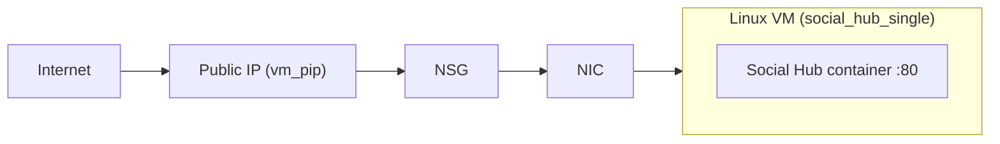
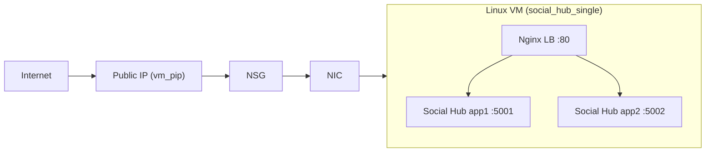

# GTA 6 DevOps Academy — Surviving Launch Day

> It is midnight on launch day. Millions of players are battering the mock
> *Rockstar Social Hub* to authenticate and load their profiles. Your job: keep
> it standing.

Starter repository for the 4-hour beginner DevOps session. You deploy a mock
Social Hub API to **Azure** with Terraform, watch a load test flatten a single
container, then "armor up" — **on the same VM** — with an Nginx load balancer in
front of two app containers.

## Architecture

One Linux VM runs Docker throughout. Only the *containers* on it change between
missions; the VM, its public IP and URL stay the same.

### Mission 1 — The Vanilla Deployment (one vulnerable container)



### Mission 3 — Armor Up (Single-VM Container HA)



All resources live inside one Resource Group (`vice-city-01-rg`), a Virtual
Network (`vice-city-01-vnet`) and Subnet (`vice-city-01-subnet`).

## Repository layout

```
app/                       Node.js/Express "Social Hub" API
docker/                    Container stack (baked onto the VM by cloud-init)
  Dockerfile               Builds the app image
  docker-compose.yml       Mission 1: one app container on :80
  docker-compose.ha.yml    Mission 3: nginx + app1 + app2
  nginx.conf               Load-balancer config (round-robins app1/app2)
terraform/                 Infrastructure as Code (Azure — one VM)
  main.tf                  Provider + Resource Group
  network.tf               VNet, Subnet, NSG
  compute.tf               Public IP, NIC, VM (installs Docker via cloud-init)
  variables.tf / outputs.tf
  cloud-init/              VM bootstrap template
loadtest/launch-day.js     k6 "midnight release" stress test
Makefile                   Shortcuts for the whole flow (run `make`)
```

## Prerequisites

- [Terraform](https://developer.hashicorp.com/terraform/downloads) >= 1.5
- [Azure CLI](https://learn.microsoft.com/cli/azure/install-azure-cli) — run `az login`
- An SSH key pair — run `ssh-keygen` if `~/.ssh/id_rsa.pub` doesn't exist
- [k6](https://grafana.com/docs/k6/latest/set-up/install-k6/) (instructor machine)

## `make` helpers

The Makefile only wraps the long, fiddly commands. Everything else —
`terraform`, `ssh`, `docker compose` — you run by hand so you learn the real
tools. The helpers auto-resolve the VM's URL/IP from Terraform outputs.

| Command | Wraps |
|---|---|
| `make loadtest` | the k6 spike (`k6 run -e TARGET=… launch-day.js`) |
| `make health` | `curl http://<ip>/api/v1/health` |
| `make logs` | tailing the active container logs over SSH |

## The missions

### 0:30 — Setup

```bash
az login
cd terraform
cp terraform.tfvars.example terraform.tfvars
terraform init
```

### Mission 1 — Vanilla Deployment

```bash
terraform apply
terraform output social_hub_url     # -> http://<public-ip>
```

Give the VM ~2–3 minutes to install Docker and start the container, then:

```bash
curl "$(terraform output -raw social_hub_url)/api/v1/profile?id=42"
```

Concepts: IaC basics, state files, a single Docker container as the bottleneck.

### Mission 2 — The Midnight Release (chaos!)

Instructor blasts the single container (from the repo root):

```bash
make loadtest
```

One Node process is CPU-bound on `/api/v1/auth`, so the single container maxes
one core and tips over into timeouts / 504s. SSH in and watch the carnage:

```bash
ssh rockstar@$(terraform -chdir=terraform output -raw vm_public_ip)
sudo docker ps                      # one container
exit
make logs                           # or tail the logs via the helper
```

### Mission 3 — Armor Up (Single-VM Container HA)

No new infrastructure. SSH onto the **same VM** and swap the single container
for an Nginx load balancer in front of **two** app containers:

```bash
ssh rockstar@$(terraform -chdir=terraform output -raw vm_public_ip)
cd /opt/social-hub
sudo docker compose -f docker-compose.yml down
sudo docker compose -f docker-compose.ha.yml up -d --build
sudo docker ps                      # nginx + app1 + app2
exit
```

Concepts: SSH, Docker Compose, load balancing, horizontal scale.

### Mission 4 — Round 2 Load Test

Same command, same URL:

```bash
make loadtest
```

Nginx round-robins across both containers (watch the `host` field in the JSON
responses flip between `app1`/`app2`), so the error rate falls toward **0%** and
the k6 thresholds go green.

### Mission 5 — Busted (cleanup)

> "The Feds are here!" Scrub all the evidence.

```bash
terraform destroy
```

## Notes

- **Why a B2s (2 vCPU) VM:** Node is single-threaded, so one container already
  saturates one core. The Mission 3 fix only adds throughput if there's a second
  core for the second container — on a 1-vCPU box it wouldn't help. Set in
  `terraform/variables.tf` (`vm_size`).
- **Why it crashes:** `app/server.js` runs a heavy *synchronous* PBKDF2 hash in
  `/api/v1/auth`, blocking the Node event loop. The fix is horizontal scale
  (more containers behind a load balancer), not code. Tune the drama with the
  `HASH_ITERATIONS` env var.
- **Cost:** one `Standard_B2s` VM. Trivial per hour, but run Mission 5 —
  `terraform destroy` — to stop the meter. Use a sandbox subscription with a budget.
- **Single source of truth:** the VM is provisioned with the exact files from
  `app/` and `docker/` (embedded via cloud-init). Change those dirs, not copies
  on the VM.

